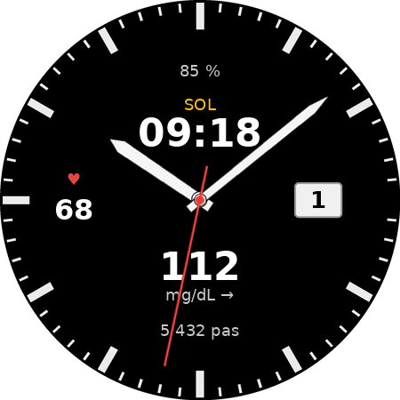

# Cadran solaire pour Wear OS

Un cadran analogique pour montre Wear OS qui affiche l'**heure solaire vraie**, la **glycémie** (via [Juggluco](https://github.com/j-kaltes/Juggluco)) la **fréquence cardiaque**, les **pas du jour** et la **batterie**, sans compte Google ni Samsung et sans téléphone.



- **En haut** : l'heure solaire vraie, en 24 h. Il est 12:00 quand le soleil passe au plus haut à l'endroit où vous êtes.
- **En bas** : la glycémie et sa tendance, fournies par Juggluco (par exemple avec un FreeStyle Libre 2 connecté directement à la montre).
- **À 9 h** : la fréquence cardiaque, mesurée toutes les 5 minutes.
- **À 3 h** : la date, dans un guichet.
- **Sous 12 h** : la batterie de la montre en %, en rouge à 15 % et moins.
- **Au-dessus de 6 h** : les pas du jour.
- Une trotteuse rouge, masquée quand l'écran est en veille.

Les deux applis qui accompagnent le cadran ont aussi leurs propres fonctions :
- **Heure solaire** : un **réveil solaire**. Vous choisissez la durée de sommeil, et le coucher et le lever sont placés de part et d'autre du minuit solaire, avec un rappel 15 minutes avant le coucher.
- **Pouls** : un **historique** de toutes les mesures, avec une courbe sur 1 h, 24 h, 7 jours ou 30 jours, et l'**envoi en CSV au téléphone par Bluetooth**, sans appli sur le téléphone.

Tout reste sur la montre : aucun compte, aucun serveur.

Conçu sur une Galaxy Watch4 Classic (SM-R885F) sans Samsung Health ni Play Store. Il devrait fonctionner sur toute montre Wear OS 4 ou plus récente.

## Les trois APK

| APK | Paquet | Rôle |
|---|---|---|
| `heuresolaire.apk` | `io.github.mariechantal.heuresolaire` | Appli et complication « Heure solaire ». Elle calcule l'écart entre l'heure solaire et l'heure légale. Réveil solaire. |
| `pouls.apk` | `io.github.mariechantal.pouls` | Appli et complication « Fréquence cardiaque ». Elle lit directement le capteur de la montre, sans Samsung Health ni Health Services. Historique, courbe et envoi Bluetooth. |
| `cadran-solaire.apk` | `io.github.mariechantal.cadransolaire` | Le cadran, au format [Watch Face Format](https://developer.android.com/training/wearables/wff) v2. Il ne contient aucun code. |

Chaque complication marche aussi sur d'autres cadrans, et le cadran accepte d'autres complications à la place des siennes.

## Installation

1. Téléchargez les APK sur la page [Releases](../../releases/tag/apk). Elle est mise à jour à chaque modification de la branche `main`.
2. Installez-les sur la montre avec un outil ADB, par exemple GeminiMan WearOS Manager (« Sideload APK ») ou `adb install`. Installez `heuresolaire.apk` et `pouls.apk` d'abord, puis `cadran-solaire.apk`.
3. Ouvrez **Heure solaire** sur la montre, acceptez la localisation et touchez « Mettre à jour la position », de préférence dehors.
4. Ouvrez **Pouls** et touchez « Autoriser le capteur » deux fois : d'abord « Autoriser », puis « Toujours autoriser ». La complication lit le capteur en arrière-plan.
5. Pour la glycémie, installez la version montre de Juggluco et configurez-la (connexion directe au capteur ou relais depuis le téléphone).
6. Faites un appui long sur le cadran actuel et choisissez **Cadran solaire glycémie**.
7. Facultatif : dans **Heure solaire → Réveil solaire**, choisissez la durée de sommeil, activez le réveil et acceptez les notifications.

Les quatre complications sont choisies automatiquement quand le cadran est ajouté. Sinon, faites un appui long sur le cadran, puis **Personnaliser** :
- en haut, **Heure solaire** ;
- en bas, **Juggluco**, complication « valeur + flèche » en texte court ;
- à gauche, **Pouls → Fréquence cardiaque** ;
- en bas, sous la glycémie, le podomètre : celui du système par défaut, ou **Google Fit → Pas** pour avoir le même compte que dans Fit.

> **Mise à jour** : les APK de la CI sont signés avec une clé de debug qui change à chaque compilation. Pour installer une nouvelle version, désinstallez d'abord l'ancienne :
> `adb shell pm uninstall io.github.mariechantal.heuresolaire` (et de même pour `io.github.mariechantal.pouls` et `io.github.mariechantal.cadransolaire`).
> La désinstallation efface les réglages et l'historique de l'appli. Elle retire aussi sa complication du cadran : remettez-la ensuite avec **Personnaliser**.

## Fonctionnement

### Heure solaire

```
heure solaire = UTC + longitude × 4 min + équation du temps
```

L'équation du temps vient de la formule de la NOAA (précision d'environ 30 s). Par exemple, à Rennes (longitude −1,68°) le 1er novembre, l'équation du temps vaut +16,4 min : le midi solaire tombe donc à 12:50 heure légale.

La complication transmet seulement l'**écart en minutes** (type `RANGED_VALUE`). Le cadran ajoute cet écart à l'heure courante. L'heure solaire avance ainsi chaque minute sans réveiller l'appli, qui ne recalcule l'écart qu'une fois par heure ou lors d'un changement d'heure ou de fuseau.

**GPS et batterie** : le GPS n'est utilisé que lorsque vous ouvrez l'appli Heure solaire (ou que vous touchez l'heure solaire sur le cadran). En arrière-plan, l'appli lit seulement la dernière position connue du système. Un degré de longitude décale l'heure solaire de 4 minutes, donc il suffit de mettre la position à jour en voyage.

### Réveil solaire

Dans l'appli Heure solaire, touchez « Réveil solaire » et choisissez la durée de sommeil (de 4 h à 12 h, par demi-heure). La nuit est centrée sur le minuit solaire :

```
coucher = minuit solaire − durée / 2        lever = minuit solaire + durée / 2
```

Avec 8 h de sommeil, on se couche à 20:00 et on se lève à 04:00 en heure solaire, soit 20:50 et 04:50 en heure légale à Rennes en novembre, ou 22:13 et 06:13 à la mi-juillet.

- Une vibration et une notification préviennent 15 minutes avant le coucher.
- Au lever, la montre sonne et/ou vibre (deux réglages indépendants) jusqu'à ce que vous touchiez « Je suis debout ». Il n'y a pas de répétition. La sonnerie s'arrête d'elle-même au bout de 10 minutes.
- Le réveil sonne tous les jours. Les horaires se recalculent chaque jour, au changement d'heure et quand la position change.

### Fréquence cardiaque

Toutes les 5 minutes, la complication allume le capteur cardiaque (`Sensor.TYPE_HEART_RATE`) jusqu'à obtenir une mesure fiable, en 20 s au plus, puis l'éteint. Elle ignore les lectures sans contact avec la peau ou peu fiables, comme le fait [OpenVitals](https://github.com/OpenVitals-MTU/android-app). Si aucune mesure ne date de moins de 30 minutes, elle affiche `--`. Touchez la valeur pour ouvrir l'appli Pouls. Son bouton **Mesurer maintenant** lance une mesure tout de suite, même si la complication n'est sur aucun cadran.

Les mesures toutes les 5 minutes n'ont lieu que si la complication est affichée sur un cadran actif.

### Mesure à 30 s (séance de sport)

Le bouton **Mesure à 30 s** de l'appli Pouls garde le capteur allumé et enregistre une mesure toutes les 30 secondes, au lieu d'une toutes les 5 minutes. Un second appui, ou le bouton « Arrêter » de la notification, revient au rythme normal. Le mode s'arrête de lui-même au bout d'une heure. Pendant ce temps, le cadran affiche la valeur à chaque nouvelle mesure, et la vue « 1 heure » de l'historique montre toute la séance.

### Historique du pouls

Chaque mesure est enregistrée sur la montre (instant et valeur, dans une base SQLite locale). Le bouton **Historique** de l'appli Pouls affiche la courbe sur 1 heure, 24 heures, 7 jours ou 30 jours (touchez la courbe pour changer de période), avec le minimum, la moyenne et le maximum. Une mesure prend environ 30 octets, soit 9 Ko par jour et 3 Mo par an : la place ne manque jamais, et tout est conservé.

**Envoyer au téléphone** écrit l'historique complet en CSV (`date,timestamp_ms,bpm`) et l'envoie par Bluetooth au téléphone associé, avec le profil OPP, comme « Partager par Bluetooth » sur Android. Aucune appli n'est nécessaire sur le téléphone : il demande d'accepter le fichier et le range dans ses téléchargements. Si plusieurs appareils sont associés, l'appli demande lequel choisir.

### Batterie et pas

La batterie vient directement du cadran (`[BATTERY_PERCENT]` du Watch Face Format) : rien à configurer. Les pas sont une complication : le podomètre du système par défaut, ou celui de Google Fit si vous le choisissez dans l'éditeur. Si la source fournit son propre libellé (« Pas » chez Google Fit), il est affiché à la place de « pas ».

### Glycémie

Le cadran choisit d'office la complication texte « valeur + flèche » de Juggluco (`ShortArrowValueDataSourceService`), et à défaut son image « valeur + flèche » (`ArrowDataSourceService`). C'est le même choix que dans le cadran fourni avec Juggluco.

## Autorisations

| Appli | Autorisation | Pourquoi |
|---|---|---|
| Heure solaire | Localisation | Connaître la longitude, seulement quand l'appli est ouverte. |
| Heure solaire | Alarmes exactes, démarrage, vibreur, notifications | Réveil solaire et rappel du coucher. |
| Pouls | Capteurs corporels, y compris en arrière-plan | Mesurer la fréquence cardiaque pour la complication. |
| Pouls | Appareils Bluetooth à proximité | Envoyer l'historique au téléphone. |
| Pouls | Service au premier plan, maintien en éveil, notifications | Mesure à 30 s pendant une séance de sport. |

Aucune des deux applis n'a accès à Internet.

## Compiler

### Avec GitHub Actions
Chaque push lance le workflow [`build.yml`](.github/workflows/build.yml) : JDK 17, Gradle 8.10.2, puis `gradle assembleDebug`. Les APK apparaissent comme artefact de l'exécution, et ceux de `main` sont aussi publiés dans la release `apk`.

### En local
Avec Android Studio, ouvrez le dossier et lancez *Build → Build APK(s)*. Avec Gradle 8.10 et le SDK Android 35 installés, lancez `gradle assembleDebug`.

### Images
Le fond, les aiguilles et l'aperçu sont générés avec Pillow :
```
python3 outils/dessiner.py cadran/src/main/res/drawable-nodpi
```

## Arborescence

```
heuresolaire/   appli et complication Heure solaire, réveil solaire (Kotlin)
pouls/          appli et complication Fréquence cardiaque, historique, envoi Bluetooth (Kotlin)
cadran/         cadran Watch Face Format (res/raw/watchface.xml)
outils/         génération des images
```

## Remerciements

- [Juggluco](https://github.com/j-kaltes/Juggluco) de Jaap Korthals Altes, pour la glycémie et son cadran de référence.
- [OpenVitals](https://github.com/OpenVitals-MTU/android-app), pour la façon de lire le capteur cardiaque.

## Licence

Ce projet est distribué sous la licence [GNU GPL v3](LICENSE) (GPL-3.0-or-later).

Ce projet ne remplace pas un dispositif médical. Ne prenez aucune décision de traitement sur la seule base de l'affichage du cadran.
